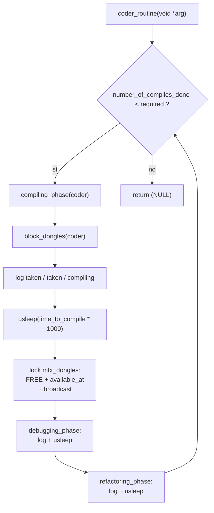
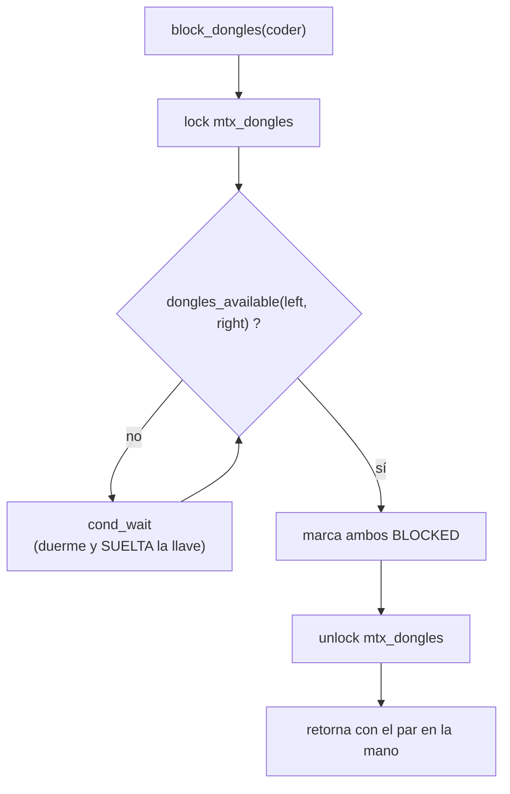
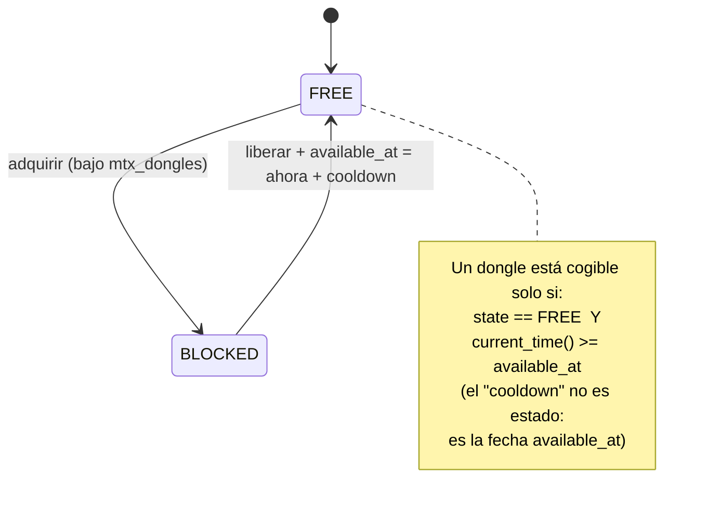
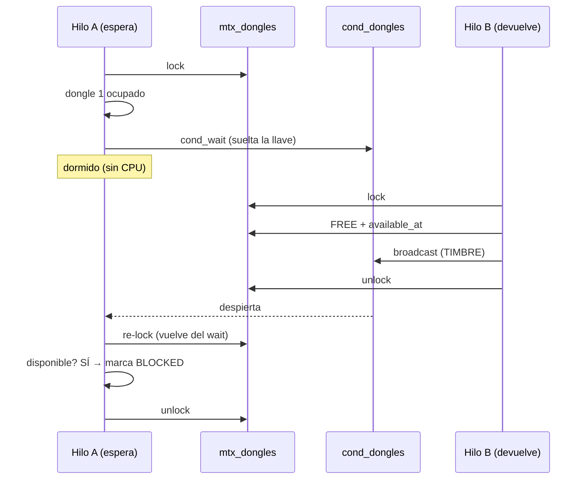
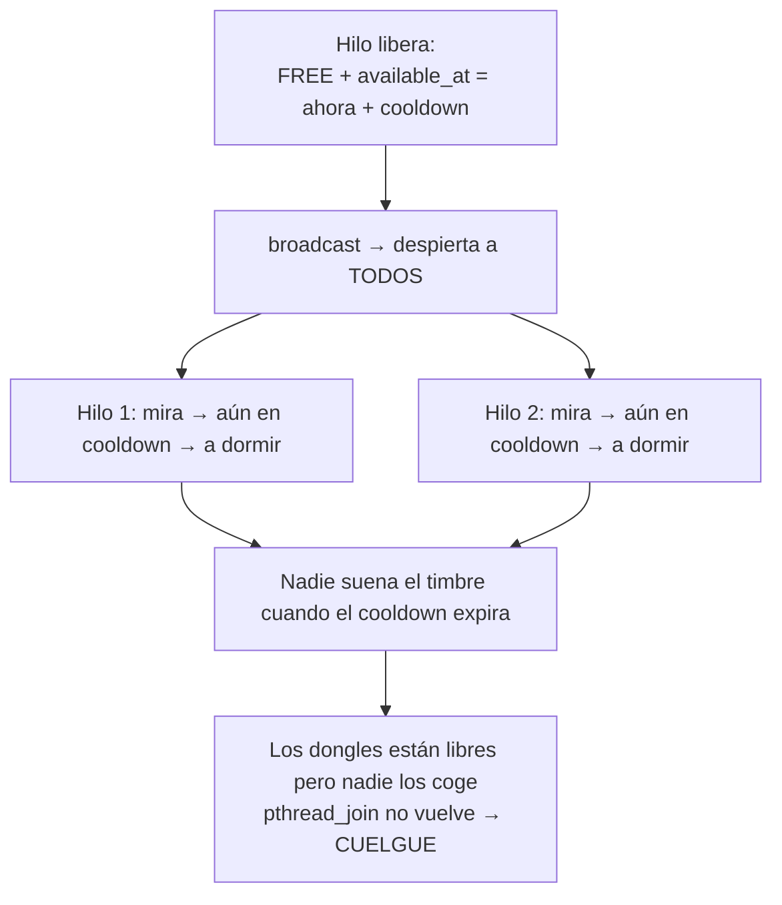
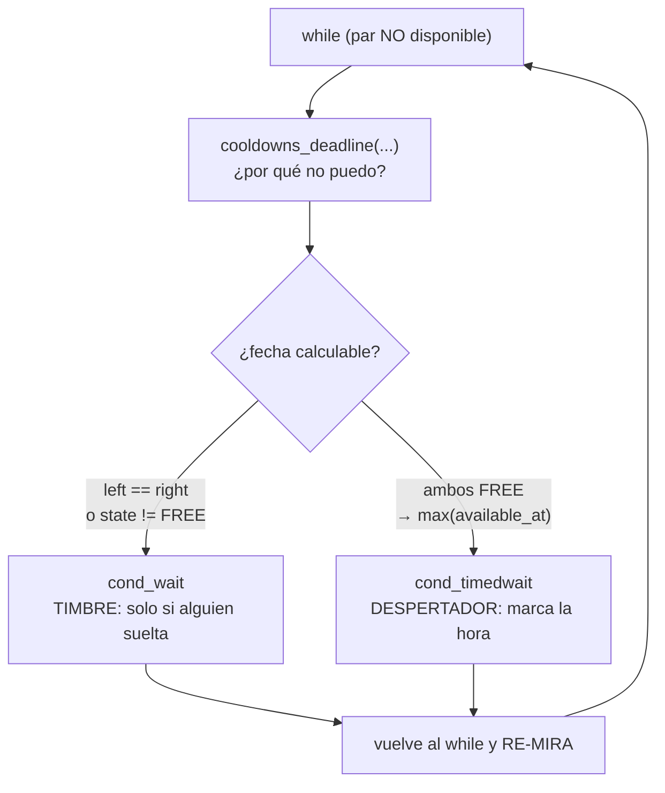
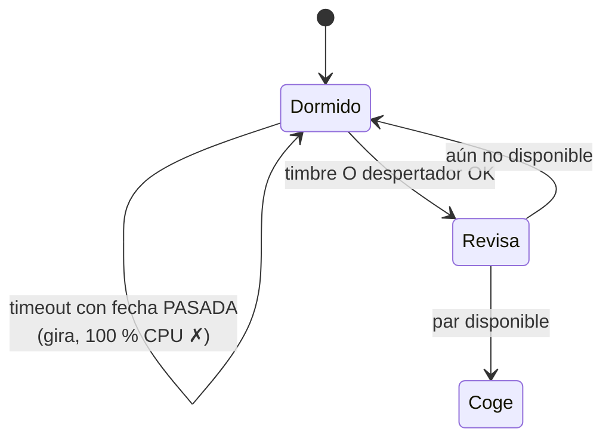

# DIAGRAMAS — Codexion (Mermaid)

> Diagramas del ciclo del coder y de la sincronización. Se renderizan como dibujo
> en GitHub, GitLab y VS Code (con extensión de Mermaid).
> Estado: **Hito 2 cerrado; 3.4 y 2.8 cerrados.** `cooldowns_deadline` +
> `pthread_cond_timedwait` cableados y verificados (`exit=0`). La sección 6 es el
> problema que había; la 6b es la solución aplicada.

---

## 1. Ciclo de vida del hilo



Sin llave durante el trabajo (E, G, H). Con llave solo para cambiar estado
(C1 y F).

---

## 2. Adquisición: `block_dongles`



No hay camino de fallo: cuando sale del `while`, el par está disponible porque
lo acaba de comprobar dentro de la llave. Por eso la función es `void`.

---

## 3. Estados reales de un dongle



---

## 4. La espera y el timbre, hilo contra hilo



El timbre va **dentro** de la llave y **después** del cambio de estado. Si
sonara antes, A despertaría, vería el estado viejo, volvería a dormirse y ya
nadie volvería a sonar.

---

## 5. Línea temporal — dos coders (esquema, cooldown no observable)

> Esquema conceptual de la coreografía correcta. Ojo: el parser **rechaza el 0**,
> así que no existe una ejecución real con `dongle_cooldown = 0`; y con cooldown
> > 0 el programa se cuelga hoy (3.4, sección 6). Es el mundo *después* de
> cerrar 3.4.

```mermaid
gantt
    title Ciclo de dos coders que comparten el dongle 1 (ms)
    dateFormat x
    axisFormat %s

    section Coder 1
    coge dongles (0)          :milestone, m0, 0, 0
    compila (50 ms)           :a1, 0, 50
    depura (30 ms)            :a2, 60, 90
    refactoriza (20 ms)       :a3, 90, 110

    section Coder 2
    espera en cond_wait       :b0, 0, 60
    compila (50 ms)           :b2, 60, 110
```



Log que produce el tramo (formato del subject):

```text
0 1 has taken a dongle
0 1 has taken a dongle
0 1 is compiling
60 1 is debugging
90 1 is refactoring
60 2 has taken a dongle
60 2 has taken a dongle
60 2 is compiling
```

---

## 6. El cuelgue del cooldown sin timbre — **ya resuelto** (3.4)



El `broadcast` avisa cuando un dongle **se libera**, no cuando **termina de
enfriarse**. Ese es el cuelgue que existía. La solución aplicada (ver
`CONTROL.md`, "Hallazgos del 3.4"): `pthread_cond_timedwait` con un `timespec`
calculado desde `available_at`. **Implementado y verificado el 2026-10-21.**

---

## 6b. La solución: dos motivos, dos funciones, un solo `while` (aplicada)



Dos reglas del dibujo:

- **El `while` no despierta**: solo re-mira. Despiertan el **timbre** y el
  **despertador**, y los dos caen en la misma puerta.
- **La elección se repite en cada vuelta**: puede cambiar de `cond_wait` a
  `timedwait` entre iteraciones sin que el bucle se entere.



---

## 7. Mapas mentales de un vistazo

```mermaid
mindmap
  root((Codexion))
    Compartido
      mtx_dongles
        state_dongle
        available_at
      mtx_log
        printf
      cond_dongles
        espera y timbre
    Reglas de oro
      No dormir con la llave
      Log fuera de la sección crítica
      while, no if, en el wait
      broadcast tras el cambio de estado
      ms son microsegundos en usleep
      ¿Por qué no puedo? (state), no ¿puedo?
      Fecha estrictamente futura o gira al 100 %
```
